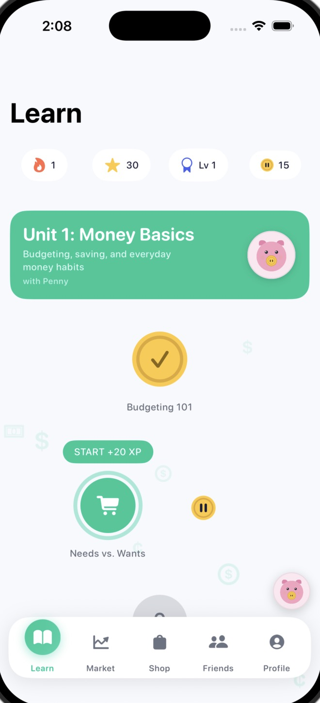
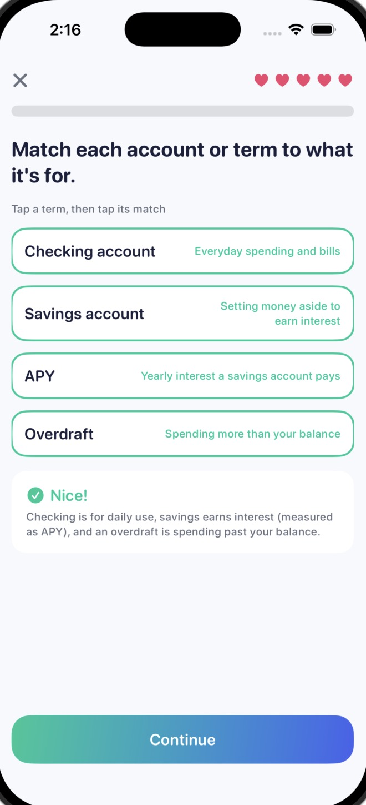
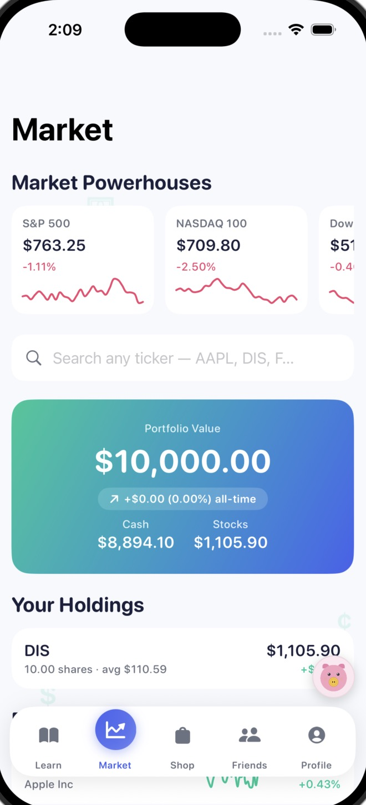
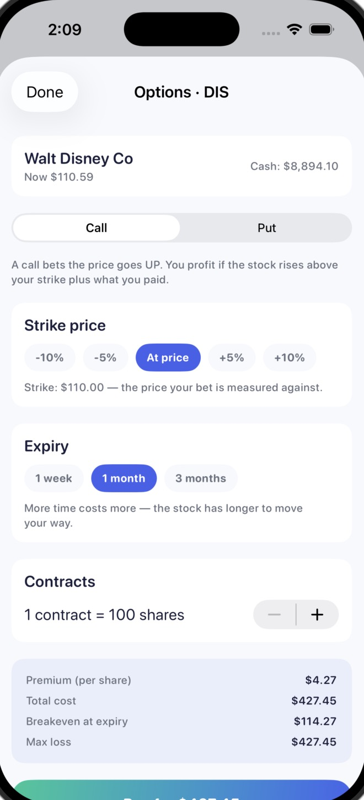
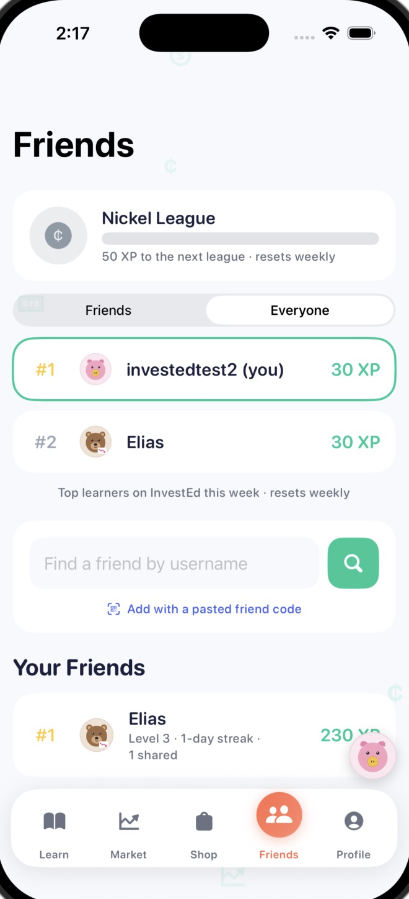

# InvestEd

**A free iPhone app that teaches teens personal finance and investing through bite-sized lessons and a live, risk-free stock market simulator.**

> Built for the 2026 Congressional App Challenge.
> _[FILL IN: your name]_ · Bellarmine College Preparatory, San Jose · _[district]_

<p align="center">
  
  
  
  
  
</p>

---

## The problem

California won't require a personal-finance course to graduate until the class of 2031, and the law covers only public high schools ([EdSource](https://edsource.org/2026/california-high-school-finance-course/759788)). Until then, most students can finish high school without learning how a paycheck, a credit score or an index fund works, while living in one of the most expensive regions in the country. _[FILL IN: one or two sentences on why this matters to you personally.]_

## What it does

| | |
|---|---|
| **Adaptive placement test** | 10 questions that get harder when you're right and easier when you're not, so you start at the level you can actually sustain — not at square one. |
| **12-unit learning path** | 60 lessons and 420 questions, from budgeting and paychecks to credit, compound interest, index funds, macroeconomics, investor psychology, crypto and quant basics. Each unit ends with a 15-question Knowledge Check that gates the next one. |
| **8 interactive question types** | Multiple choice, true/false, select-all, ordering, matching, numeric entry (with a slider), sort-into-buckets, and *build-an-option*, where you construct a real call or put to fit a scenario. |
| **Live market simulator** | $10,000 in virtual cash, real stock prices from Finnhub, search any U.S. ticker, buy and sell shares, and trade options priced with Black-Scholes. |
| **Penny, your guide** | A piggy-bank mascot on every screen with hand-written tips about what you're looking at. |
| **Motivation that lasts** | XP, levels, daily streaks with Streak Freezes, Gold earned from lessons, an avatar shop, friends, and weekly leagues against friends or everyone on the app. Nothing in the app costs real money. |

---

## How it's built

```
┌──────────────────────── iPhone (SwiftUI) ────────────────────────┐
│  Views ──► ViewModels (MVVM) ──► Services                        │
│  Learn · Market · Friends · Shop · Profile                       │
└───────┬───────────────────────┬──────────────────────────┬───────┘
        │                       │                          │
   Firebase Auth          Firebase Firestore      Cloudflare Worker (JS)
   (email sign-in)        users, friendRequests    GET /market/...  → Finnhub (quotes)
                          + security rules         The API key lives here as a secret,
                                                   never in the app.
```

| Layer | Technology |
|---|---|
| App | Swift, SwiftUI, Swift Charts, Swift Testing — iOS 26 |
| Accounts & data | Firebase Authentication, Cloud Firestore |
| Backend | Cloudflare Workers (JavaScript) |
| Market data | Finnhub API (free tier) |
| Content pipeline | JSON lesson files + Python generator |

Everything runs on free tiers — the app costs nothing to use or to operate at classroom scale.

### Engineering highlights

- **Content as data.** Hand-maintaining hundreds of questions in Swift was error-prone, so lessons are written as JSON (`content_src/units/`) and `tools/gen_content.py` compiles them into type-safe Swift. It also assembles each unit's Knowledge Check automatically from that unit's lessons.
- **Adaptive placement** (`OnboardingViewModel.swift`) — a small computerized-adaptive-testing loop: correct answers raise the difficulty and are worth more points, so the score reflects sustained level, not just a count.
- **Options pricing** (`MarketModels.swift → OptionPricer`) — Black-Scholes implemented from the formula, with tests for known values and put-call parity.
- **API key kept off the device.** Anything compiled into an app can be extracted, so the Worker holds the Finnhub key as a secret. It also caches quotes at the edge (15 s) and company names (7 days) so the free Finnhub tier (~60 calls/min) is shared across every user.
- **Security rules.** Firestore rules (`backend/firestore.rules`) let each user write only their own document and only see friend requests they're part of. Two-way friendships are completed by each side writing its own record, so no user ever writes to anyone else's data.
- **Accessibility.** VoiceOver labels on the learning path and stats, and the pulsing "current lesson" animation turns off with Reduce Motion.

### Tests

`InvestEdTests/` (Swift Testing) covers the logic that has to be right:

| Suite | What it checks |
|---|---|
| `ContentIntegrityTests` | 12 units × 5 lessons × 7 questions, unique IDs, every question accepts its own correct answer and rejects wrong ones |
| `GradingEdgeTests` | Grading rules for all 8 question types: exact sets, exact order, every pair matched, numeric tolerance, mismatched answer types rejected |
| `LearnGatingTests` | Lesson, unit and Knowledge Check unlock rules; hearts and failure |
| `OptionPricerTests` | Black-Scholes known values, put-call parity, intrinsic value, breakeven, expiry |
| `UserModelTests` | Levels, lifetime and weekly XP, earning and spending Gold, calendar-day streak math |

Run them in Xcode with **⌘U**.

---

## Project structure

```
InvestEd/
├── Con-Mod-Ser-Uti-VMo/
│   ├── Models/        AppUser, Lesson/Question, Stock/Option, friends
│   ├── ViewModels/    Learn, Market, Portfolio, Friends, Onboarding, Settings…
│   ├── Services/      Firestore, Auth, MarketData (via Worker), Notifications
│   ├── Content/       Generated lessons + placement questions
│   └── Utilities/     Theme, constants, offline sample quotes
└── Onboarding/
    ├── Views/         Onboarding flow + the five main tabs
    └── Components/    Reusable UI: question views, buttons, Penny, tab bar
backend/               Cloudflare Worker + Firestore security rules
content_src/units/     Lesson source (JSON), one file per unit
tools/                 Content generator and audit scripts
InvestEdTests/         Unit tests
```

## Running it

1. Open `InvestEd.xcodeproj` in Xcode 26 and run on an iOS 26 simulator.
2. The app ships pointing at the deployed Worker, so live market data works out of the box. To run your own backend: in `backend/`, `wrangler secret put FINNHUB_API_KEY`, then `wrangler deploy`, and update `Constants.workerURL`.
3. If the network is unavailable, the simulator falls back to built-in sample quotes.

---

## Third-party libraries and services

| Name | Use | License |
|---|---|---|
| [Firebase iOS SDK](https://github.com/firebase/firebase-ios-sdk) (Auth, Firestore) and its Google dependencies (abseil, gRPC, leveldb, nanopb, Promises, GoogleUtilities, GTMSessionFetcher, AppCheck) | Accounts and database | Apache 2.0 / BSD |
| [swift-algorithms](https://github.com/apple/swift-algorithms), [swift-numerics](https://github.com/apple/swift-numerics) | Pulled in by Firebase | Apache 2.0 |
| Finnhub API | Live stock quotes and symbol search | Free tier |
| Cloudflare Workers | Backend proxy | Free tier |

All app code, lesson content and the backend Worker are original to this project.

## Use of AI tools

_Required by the Congressional App Challenge rules. Be specific and honest — judges value clear disclosure._

- **AI tools used:** _[FILL IN — e.g. Claude (Anthropic) for …; ChatGPT for …]_
- **What AI helped with:** _[FILL IN — e.g. drafting boilerplate, debugging Swift 6 concurrency errors, first drafts of quiz questions which I then fact-checked]_
- **What I designed and decided myself:** _[FILL IN — the idea and audience, the curriculum order, the gamification design, the architecture choices (free tiers, Worker proxy), which features to cut, testing and fixing on device…]_
- **At runtime:** the app itself uses no AI. Penny's tips and all lesson content are fixed text.

## What's next (2.0)

- Spaced-repetition "review your mistakes" sessions
- A teacher dashboard so a class can run a shared league
- Placement that can start advanced learners beyond Unit 3
- Real portfolio history (daily value snapshots) instead of generated charts
